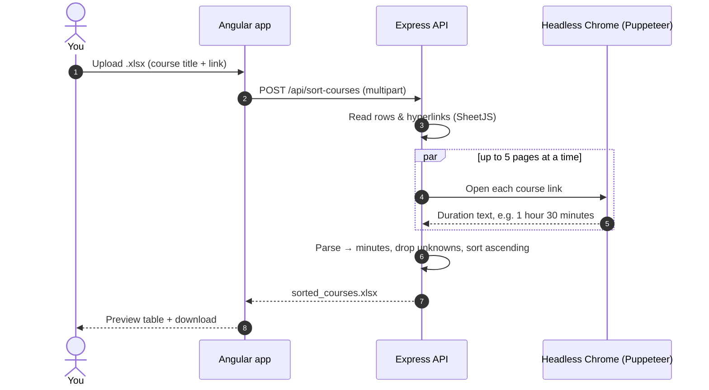

<div align="center">

# 🕹️ Google Arcade Guider

**Upload your Google Cloud Arcade course sheet and get it back sorted from shortest to longest — so you can knock out the quickest badges first.**

[](https://google-arcade-guider.vercel.app)


-217346?style=flat-square&logo=microsoftexcel&logoColor=white)


[How it works](#-how-it-works) · [Features](#-features) · [Getting Started](#-getting-started) · [API](#-api) · [Structure](#-project-structure)

</div>

---

## 🤔 Why?

Google Cloud Arcade hands out long lists of courses and labs. Each one takes a different amount of time, but the list doesn't tell you how long. **Arcade Guider** visits every link for you, reads its duration and returns the list **sorted by time** — a ready-made plan of attack.

## 🔄 How it works



## ✨ Features

- 📤 **Simple upload** of an Excel sheet — links can be real hyperlinks or plain URLs
- 🕷️ **Parallel scraping** with Puppeteer, limited to 5 concurrent pages via `p-limit`
- 🧮 **Smart duration parsing** — understands "X hours", "Y minutes" and combinations, with a text-walk fallback when the main selector is missing
- 📊 **Instant preview** of the sorted result in a table, plus a one-click `.xlsx` download
- 📈 **Upload progress** and a **global loader** driven by an Angular `HttpInterceptor`
- 🧩 Built on **Angular 20 standalone components & signals**

## 🚀 Getting Started

### Prerequisites

- Node.js 18+
- Angular CLI: `npm install -g @angular/cli`

<details open>
<summary><b>1️⃣ Backend (<code>server/</code>)</b></summary>

```bash
cd server
npm install
npm run dev        # nodemon → http://localhost:3000
```

Locally, Puppeteer uses the Chrome it downloads on install. On Render (`RENDER` env var set) it switches to the bundled `chromium` package automatically.

</details>

<details open>
<summary><b>2️⃣ Frontend (repo root)</b></summary>

```bash
npm install
ng serve           # http://localhost:4200
```

The API URL lives in [`src/environments/environment.ts`](src/environments/environment.ts) — point `apiUrl` at `http://localhost:3000` for local development.

</details>

<details>
<summary><b>📄 Expected input sheet</b></summary>

| Column A (Title — hyperlinked or a URL) | … other columns are kept as-is |
|---|---|
| [Build a Website on Google Cloud](https://www.cloudskillsboost.google/) | … |
| `https://www.cloudskillsboost.google/course_templates/…` | … |

The first row is treated as the header. The output adds **Duration in Minutes**, **Total Duration** and **Scrape Error** columns.

</details>

## 📡 API

| Method | Endpoint | Body | Response |
|---|---|---|---|
| `POST` | `/api/sort-courses` | `multipart/form-data` with `file` (.xlsx) | `sorted_courses.xlsx` download |

## 📁 Project Structure

<details>
<summary><b>Expand tree</b></summary>

```text
Google_Arcade_Guider/
├── src/app/
│   ├── upload/                     # upload UI, preview table, download
│   ├── loader/                     # global loader component
│   ├── interceptors/               # LoaderInterceptor
│   └── services/                   # FileHelper (HTTP + progress), LoaderService
└── server/src/
    ├── routes/courses.js           # POST /api/sort-courses
    ├── controllers/coursesController.js
    ├── services/excelService.js    # read/write xlsx
    ├── services/scraperService.js  # Puppeteer + p-limit
    └── utils/parseDuration.js
```

</details>

---

<div align="center">

Built by **[Shariq](https://github.com/Shariq2003)** · [LinkedIn](https://www.linkedin.com/in/shariq-sd)

⭐ If this saved you some Arcade time, consider giving it a star!

</div>
